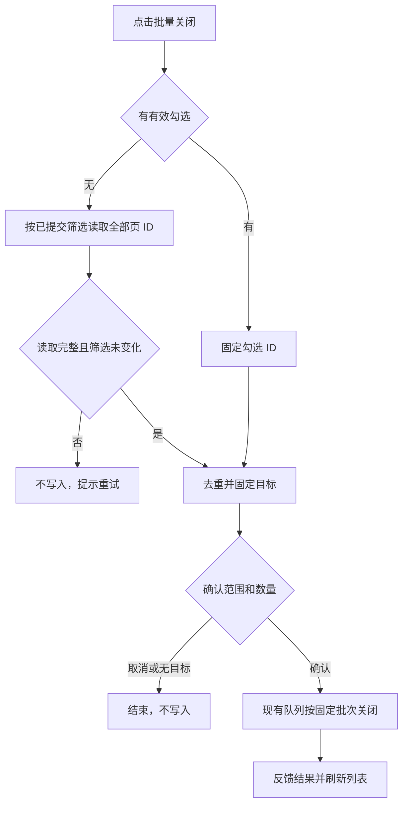
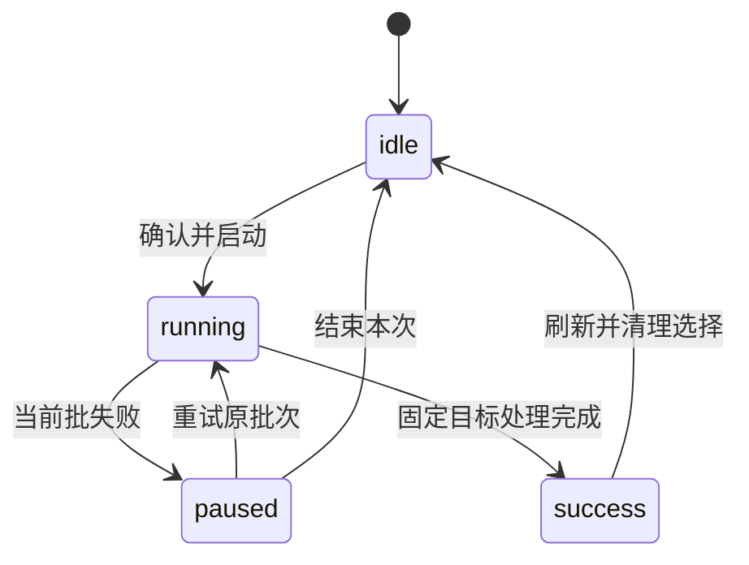

# 网站订舱与界面调整（沿用现有接口） - Plan

## Goal Capsule

- **Objective:** 运营人员能对应各处的分组信息、按明确范围批量关闭订舱任务，并通过可用的分页浏览记录，点击列表操作按钮时更不容易误触表头排序。
- **Means:** 在现有列表、修改窗口、分页和导航上局部调整，复用现有 recipe、字段块和批量队列，见 KTD1–KTD8。
- **Authority:** 客户工作簿《航线提醒-网站-请修改1018.xlsx》第二个 sheet「网站」与本对话确认的解释共同定义范围；后端不能调整，扩大间距的目的是减少按钮操作时误触表头排序。发生冲突时以最新用户确认及项目规则为准。
- **Current boundary:** 用户已要求暂不测试，本轮只更新完整方案，不写业务代码，不执行接口试写、测试或构建。Interface Evidence 保留此前的只读核查结果。
- **Stop conditions:** B1 未解决时不得宣称列表分组保存或批量关闭已联调；它不阻塞账号分组改名、列表分组展示、分页、字体和布局修改。现有接口不支持的操作不能靠前端假保存补齐。
- **Execution:** 后续实施须另有实施指令；本方案不授权发布、提交真实业务操作或建立新 worktree。

---

## Product Contract

### Summary

沿用现有后端接口，统一账号分组名称，在订舱表格补上列表分组。单条、批量修改窗口的列表分组保存按现有写接口规划，能力仍待确认。

批量关闭复用已有的关闭参数，替换关闭初始化入口并移除清除路由按钮。日志和系统设置增加 500、1000 条分页选项，列表工具栏与表头拉开距离以减少误触排序。字体及顶栏按客户参考调整，字体使用已核实可获取的官方资源。

### Problem Frame

同一分组目前在筛选区叫「CID分组」，在表格和修改窗口叫「分组2」，用户无法对应。另一个「列表分组」只在筛选区出现，无法直接查看和修改。当前关闭初始化动作与订舱开启状态不对应，日志一次显示全部数据也不便使用。客户明确指出，操作区紧邻表头会增加点击按钮时误触排序的机会。

### Delivery Boundary

| 修改项 | 计划行为 | 现有依据与交付边界 |
|---|---|---|
| 账号分组名称 | 筛选、列表、列设置、单条及批量修改统一叫「账号分组」 | 只改 `cid_group` 的显示名称，请求字段不变 |
| 列表分组展示 | 在订舱列表及列设置中新增「列表分组」 | 读取已有 `list_type`；显示部分不依赖写能力 |
| 列表分组修改 | 在现有单条、批量修改窗口中补充整数输入及回填 | 单条沿用 `/maersk/book/task`，批量沿用 `/maersk/group/task`；保存受 B1 限制，不能先上线可填写却无法保存的字段 |
| 批量关闭 | 按确认后的目标 ID 分批设置关闭状态 | 沿用 `/maersk/group/task` 和数字 `is_order=0`；已有前端调用依据，实际多条关闭结果未验证 |
| 日志分页 | 增加 500、1000 条/页 | 现有读接口已实测支持；不把新增页大小解释为已修复跨页航线筛选 |
| 系统设置分页 | 增加 500、1000 条/页及局部超时处理 | 现有读接口已实测支持；保留其他列表与全局超时默认值 |
| 列表操作区 | 拉开工具栏与表头距离，各区顶端对齐 | 前端布局修改，验收关注按钮及留白不会触发排序 |
| 字体 | 标题使用 Headline，正文与表格使用 Text | 官方 CSS 与所需 WOFF2 资源已确认可获取，按 KTD6 接入并验收加载和中文回退 |
| 顶栏 | 深蓝背景、浅色文字图标及分组箭头 | 仅调整现有导航视觉，菜单、权限和跳转保持当前契约 |

上述写入相关方案是待实施的接入设计，不代表服务端能力已全部验证。没有新增接口、后端字段或后端配合任务。

### Requirements

**Booking**

- R1. `cid_group` 在筛选、表格、列设置及修改窗口统一显示「账号分组」，请求字段名不变。
- R2. 现有 `list_type` 在订舱表格新增「列表分组」列，并在单条及批量修改中支持回填或录入；保留 `group_id` 的现有含义。
- R3. 删除「清除路由」入口，将「关闭初始化」替换为设置订舱任务关闭状态的「批量关闭」。
- R4. 批量关闭有勾选时处理勾选记录，未勾选时处理最近一次已提交筛选结果的全部页，无筛选时处理全部任务。
- R5. 关闭执行前确认操作、范围和数量，取消确认不发业务写请求；请求失败时提供可恢复反馈。

**Query and pagination**

- R6. 日志管理与系统设置增加 500、1000 条/页，保留各自现有选项、默认页大小及查询触发规则。
- R7. 500、1000 条分页请求失败时提供可见提示和重试；若保留上次表格，应明确本次数据未更新。

**Visuals and compatibility**

- R8. 将列表工具栏整体下边缘至表头点击区域的距离增加约两行正文高度，减少按钮操作时误触排序；各区顶端对齐，保留主动点击表头的正常排序。
- R9. 页面及弹窗等语义标题采用 Maersk Headline，正文、字段标签、按钮、菜单及表格采用 Maersk Text，保留中文及加载失败回退。
- R10. 顶栏参考客户截图的深蓝背景、浅色文字图标、间距和分组箭头效果，保留菜单名称、层级、权限及跳转。
- R11. 保持现有 light/dark/system 主题、只读权限、列表选择工具栏行为和用户列偏好；本次涉及的新增列应能被现有用户发现和使用。

### Key Decisions

- KD1. 「列表分组」是筛选中已有的 `list_type`，应补到表格和修改窗口；保留 `group_id`，不把「分组1」改名为列表分组。Governs R1–R2。 (session-settled: user-directed — chosen over 将分组1重命名为列表分组: 用户明确指出筛选有、表格与修改窗口缺少)
- KD2. 关闭动作与现有批量打开成对，范围按 R4，且需要 R5 的确认。Governs R3–R5。 (session-settled: user-approved — chosen over 只改关闭初始化按钮文案或只处理当前页: 用户接受反向关闭与全部筛选结果范围的建议)
- KD3. 列表分组同时加入单条和批量修改。Governs R2。 (session-settled: user-approved — chosen over 仅单条修改: 用户接受两种修改保持一致的建议)
- KD4. 所有修改以现有后端能力为边界，不依赖后端新增筛选、字段或接口。Governs R2–R7。 (session-settled: user-directed — chosen over 要求后端配合调整: 用户明确后端无法调整)
- KD5. 工具栏间距以减少按钮操作时误触排序为目的，不能仅按视觉留白验收。Governs R8。 (session-settled: user-directed — chosen over 仅作为外观间距调整: 用户明确了防误触目的)

### Scope Boundaries

- 本次覆盖现有网站需求，不处理第一个 sheet「航线提醒」的其他需求。
- 保留现有修改 Modal，不借本次字段调整改成新路由、新页面或 Drawer。
- 只调整现有导航视觉，不增加参考图中的「权限管理」等业务模块。
- 不升级 Ant Design，不引入 Maersk MDS 组件库、字体加载库或新的主题上下文。
- 不改造导出全部、后台任务持久化、刷新后续跑或业务数据回滚；这些能力不是本次需求，现有使用方式也不要求它们。
- 批量打开保留既有范围与执行行为，不借增加批量关闭重做其他批量操作。
- 不用本地存储、其他分组字段或只更新当前表格来代替服务端保存列表分组。
- 不修改后端，也不新增前端全量扫描再筛选机制；本次日志需求按新增分页选项收口。现有航线跨页筛选问题作为已知限制，不宣称已修复；如果后续要求全范围航线筛选，需要单独评估与确认工作范围。
- 不预先恢复全站虚拟滚动；只有实际浏览器证据表明既有表格无法满足 500、1000 条目标页大小时才另议渲染方案。不承诺「所有数据」一次性加载已解决，保留其现有选项与行为。

### Open Questions

| ID | 属性与影响 | 解除条件 | 责任来源 |
|---|---|---|---|
| B1 | 列表分组的单条、批量保存未证实；批量关闭已有调用依据但未完成真实回读，仅影响 U1 保存部分及 U2 的业务验收 | 取得对应管理接口的处理代码或有效写契约，或在另行获准后通过测试记录回读确认字段、空值及成功/失败语义；不支持时报告限制，不安排后端改造 | 用户已要求暂不测试；本方案不再次发起测试申请，也不安排本轮试写 |

分组、批量关闭、字体选型和后端不变的约束已确认。B1 只限定关联写功能的交付条件，不阻塞其他部分。当前不继续验证业务写接口，规划阶段也不将已有前端调用升级为服务端支持的结论。

### Known Limitations

日志航线参数在本次实测中未生效；当前前端又在取到一页后才过滤并重写总数，不能据此得到完整的跨页航线结果。增加 500、1000 条不等于修复该问题。本次保留其为已知限制，不移除兼容过滤，不声称现有航线筛选覆盖全量；无航线条件时以接口返回的 total 验证分页访问。

客户原始日志条目是「无法显示所有数据的，增加500条/页，1000条/页」。本方案将它解释为提供较大的分页浏览选项；原先要求完整修复航线筛选属于额外推断，本次撤回。若用户要求同时修复该既有缺陷，需要重新确定范围，不能默认在浏览器取齐约八万条记录。

---

## Planning Contract

### Business Classification

| 区域 | Domain / recipe | 方案 |
|---|---|---|
| 订舱、日志、系统设置及其他列表 | `list-query / list-query-standard` | 继续使用 `StandardListPageSpec -> StandardListPageRecipe` |
| 订舱单条与批量修改 | `form-management / business override` | 复用现有 `BookTaskFormFields` 与 Modal |
| 顶栏与字体 | 现有 AppShell / theme context | 局部品牌样式和统一字体入口 |

**表单选型：保留现有高级业务特例。** 当前字段约 30 个，单阶段完成，存在批量编辑能力，符合 decision matrix 的 advanced 条件；没有自然的多阶段依赖，不拆分步骤。现有用户要求修改窗口，故不迁移整页骨架，也不为单个页面建立 AdvancedFormRecipe。不增加详情或 add/readonly 路由；已有写权限及记录 ID 校验仍需保留。

### Page Modules

| 模块 | 修改边界 |
|---|---|
| 筛选区 | 账号分组改名，保留列表分组检索；草稿筛选不影响批量范围 |
| 内容区 | 新列表分组列、单条/批量字段、关闭按钮、两页分页选项、共用工具栏及导航视觉 |
| 反馈区 | 关闭确认与进度、失败暂停与恢复；新增大页加载失败与旧数据未更新提示 |
| 权限区 | 读权限沿用 `list.read`，写操作沿用 `form.write`，入口与 handler 均阻断无写权限提交 |

### Interface Evidence

以下为 2026-10-21 对项目配置的开发接口进行的只读实测。登录仅用于鉴权；不在文档保存令牌、账户数据或原始记录。样本时点总数可能继续变化。

| 核查项 | 观测 | 可据此确认 / 尚不能确认 |
|---|---|---|
| `GET /maersk/book/task?page=1&per_page=20` | 返回 20 条，总数 3500；20 条都有整数 `list_type`，`cid_group` 为整数或 null，`group_id` 为整数 | 已有列表分组读字段，不需要新建业务字段 |
| 订舱附加不存在的数字 `list_type` | 返回 0 条、total=0；有效样本值查询正常 | `list_type` 查询参数生效 |
| 单条及批量接口 OPTIONS | `/maersk/book/task` 允许 POST，`/maersk/group/task` 允许 POST | 只证明方法存在；不证明字段被接受、保存成功或事务语义，见 B1 |
| `GET /maersk/remind/list`，500/1000 条 | 分别返回 500/1000 条，约 0.52/0.95 秒；total=80220 | 两种页大小服务端支持，尚未请求 99999 条全量 |
| 日志传不存在的 `shipping_line` | 仍返回 10 条、total=80220；样本 `ship_name` 为 null | 该参数未按预期筛选，不能直接移除前端兼容过滤后宣称完成 |
| 日志使用有效航线复核 | 「加勒比」「欧洲」与未筛选请求的前 10 条 ID 完全相同、total 均为 80226 | 有效选项也未生效；此次总数较前次增加，印证它是持续变化的数据集 |
| `GET /maersk/book/list`，500 条 | 返回 500 条，约 8.86 秒；总数 3585 | 服务端支持，但会超过现有前端 5 秒超时 |
| 同接口，1000 条 | 首次 12 秒超时，重试约 8.8 秒返回 1000 条 | 服务端支持；单次成功不构成稳定性能保证 |
| 接口文档 | `docs/api/api.md` 当前为空；`/openapi.json`、`/swagger.json` 返回 404；后续找到 `/apidocs/` 与 `/apispec_1.json`，但后者的 `paths` 为空，登录后亦为空 | 文档入口存在，但没有这两个接口的字段、成功/失败或空值约定 |

**本轮写接口专项核查（2026-10-21）：**

| 操作 | 已查到的调用和实测 | 不改后端的判断 |
|---|---|---|
| 单条保存列表分组 | 单条修改调用 `POST /maersk/book/task`，JSON 带 `id`；当前保存类型及两个 payload builder 均未包含 `list_type`。读取复核 20 条记录均有整数 `list_type` | 读取与展示可复用；写入字段是否被服务端接受和持久化仍未证实，不能据此承诺保存可行 |
| 批量保存列表分组 | 批量修改调用 `POST /maersk/group/task`，JSON 的 `ids` 为逗号分隔字符串；当前没有提交 `list_type` 的调用或真实保存记录 | 现有批量入口可复用，但是否支持该字段仍未证实 |
| 批量关闭 | 当前行内开启/关闭调用同一个 `POST /maersk/group/task`，传 `ids: String(record.id)`、数字 `is_order: 0/1`；现有批量打开使用多 ID 与 `is_order: 1`。读取复核可见关闭状态 `0` 的记录 | 有现成功能和参数依据，前端方案可复用该调用；仍缺多 ID 传 `0` 后的真实回读，不能把调用代码当作已联调成功 |

同目录 `partime-boats-backend` 经路由核对是订舱执行服务，不包含 `/maersk/book/task`、`/maersk/group/task` 的处理代码，不能作为这两个管理写接口的服务端证据。现有测试使用模拟响应，也不能替代服务端验收。

现有 `updateBookTask`、`batchUpdateBookTask` 没有检查写响应的 `bool_status`，通用响应拦截器也直接放行 HTTP 成功响应。因此既有页面显示「保存成功」或「关闭成功」不足以证明业务成功。后续只在本次涉及的写请求中按已核实契约判断成功，再回读目标记录；不借此改造全站请求层。

B1 的证据要求见 Open Questions。后续若另行获准通过测试核查，先记录原值，验证列表分组单条与批量保存回读、未填字段保持原值、多 ID 关闭及业务失败响应。验证多 ID 至少需要两条不会触发真实订舱的测试任务；清空值只在契约明确后验证。不对未知 ID、空 `ids` 或真实任务进行试探性写入。

当前日志链路是服务端分页后，再用目的港映射航线并本地过滤，同时将 total 改成当前页匹配数。这会丢失后续页结果的可达性；其历史业务原因未找到。服务端虽然提供 `ship_name` 字段，但样本为 null，不能据字段存在就替换页面当前航线定义。

现有批量打开按「读一页、写一页、下一页」执行；失败重试会重新读取失败页。源代码可证明这一流程，不能证明后端排序在更新中保持不变。KTD3 因此只调整目标读取方式，不新建批量控制器。

### Font Evidence

- [Maersk 官方 Typography](https://designsystem.maersk.com/foundations/typography/)确认 Headline/Text 的职责；字体缺失时官方使用 Arial 回退。
- 2026-10-21 已成功读取官方 [fonts-cdn.css](https://assets.maerskline.com/mds/fonts/fonts-cdn.css)，HTTP 200、`text/css`。声明包含 Text 的 300/400/500/600/700 常规与斜体，以及 Headline 的 300/400/700，均设置 `font-display: swap`。
- 已读取 Text Regular/Medium/SemiBold/Bold 和 Headline Regular/Bold 共 6 份 WOFF2 文件，均为 HTTP 200、`font/woff2`、有效的 `wOF2` 容器签名，且允许跨域读取；文件大小约 27–29 KB。正文 400/500/600/700 和标题 400/700 的资源来源已明确。
- 字体文件本轮仅下载到内存核查，未写入项目或修改样式。完整字形、实际渲染和中文回退仍按 U4 验收，不把资源可获取等同于界面已接入。
- [官方开发说明](https://designsystem.maersk.com/develop/index.html)涉及私有 npm 注册表；本方案直接采用已核实的字体资源，不接入私有组件包或整套品牌 CSS。

### Key Technical Decisions

- KTD1. **保持现有边界。** 基于当前 checkout 实现 R1–R11，保留已存在的 10 个页面/测试未提交改动。遵守 KD4 的后端不变约束，保持列表 recipe、修改窗口和主题上下文，不改菜单 contract。
- KTD2. **列表分组分开展示和保存。** 按已实测整数数据使用整数输入，筛选继续保留现有 Input，不新增枚举或正数范围。保存字段仍为 `list_type`，单条附带 `id`，批量附带逗号分隔的 `ids`。批量未填写表示不修改，数字 0 不当作空白；单条清空语义由 B1 决定，其他字段的完整 payload 与 null 约定不变。两个编辑入口随保存能力一起交付，显示部分可独立完成。对应 R1–R2。
- KTD3. **关闭前固定目标，再分批处理。** 复用 `fetchAllBookTaskIds` 收集并去重目标，按服务端真实页大小核对完整性，再确认并冻结 ID 与动作。复用现有 `useBatchQueueTask` 对固定 ID 每 100 条设置 `is_order=0`，重试仍是原失败批次。准备期间筛选版本变化则丢弃准备结果；新查询/重置清理旧选择。失败暂停时可重试或结束本次，已成功批次不回滚。对应 R3–R5。
- KTD4. **页大小配置留在两页。** 只在日志与系统设置传入 500/1000，保留共享默认值。系统设置的这两种大页请求使用局部 20 秒超时以覆盖本次观测，其他请求保留全局 5 秒；20 秒失败须可见并可重试，不作无限自动重试。对应 R6–R7。
- KTD5. **日志仅补已证实可用的分页能力与加载反馈。** 使用现有分页接口，不调整航线筛选策略，不为本次新增全量取数或 partial 判定机制。按照 R7 处理新增大页的网络错误及超时，复用既有反馈与重试；不能将失败后的旧数据标为新查询成功。航线跨页限制按 Known Limitations 交代。
- KTD6. **按已核实的官方字体资源自托管。** 从官方 CDN 获取实际使用的 WOFF2，放入既有 `public/` 的子目录，CSS 与 AntD `ConfigProvider.token.fontFamily` 使用同一正文字体栈，标题单独限定到语义标题。表头保持 Text，静态 message、弹层也验证。采用 swap 并保留系统中文回退，不改全局字号或伪造静态字体的可变字重。对应 R9。
- KTD7. **操作区与排序区保持物理隔离。** 共用 recipe 在现有 16px 下间距上增加约两个正文行高，按当前约 22px 行高以约 60px 总间隔作为初版测量目标，再用最终字体校准。留白必须位于表头命中区域之外，换行后按整个工具栏底边计算。若真实页面出现点击按钮本体也触发排序，应检查覆盖、命中区域或事件路径，不用加大留白掩盖，也不预先加入全局事件拦截。顶栏继续用局部语义变量和 Menu token，内容区主题不变；AntD 6.3.5 的横向菜单箭头需局部处理。对应 R8–R11、KD5。
- KTD8. **仅为订舱新增列迁移偏好。** 在现有列偏好读取处执行由订舱显式声明的一次新列补入，保留其他可见列、顺序和密度；迁移后用户手动隐藏须被尊重。不重置表 ID 或全站偏好，不建立新偏好系统。对应 R2、R11。
- KTD9. **订舱写请求检查业务结果。** 在订舱 API 文件内定义写响应类型并复用已有 envelope 解析能力，对明确的业务失败抛错，使表单保留输入、批量队列暂停。成功判定按 B1 的已确认契约执行，不仅凭 HTTP 200 提示完成；字段持久化在获准的真实联调中回读验收，不增加每次提交后全量扫描的机制。对应 R2、R5。

### Implementation Sequence

先在 U4 接入已核实的字体资源，再完成 U1 的改名与列表展示、U3 分页、U5 防误触布局和 U6 顶栏，以最终字体测量列宽与间距，减少重复校准。U1 保存部分与 U2 按现有接口接入设计保留，业务验收受 B1 限制。

### High-Level Technical Design

### Reuse Map

| 现有文件/组件 | 复用职责 |
|---|---|
| `src/shared/template-kit/recipes/standard-list-page-recipe.tsx` | 8 个列表共用工具栏、反馈及分页 |
| `src/shared/template-kit/list/template-list-filter-form.tsx` | 筛选输入及查询/重置，不改即时查询策略 |
| `src/shared/hooks/use-standard-pagination.ts` | 页大小、回第一页及所有数据标签 |
| `src/shared/hooks/use-batch-queue-task.ts` | 顺序执行、失败暂停及重试，优先不改 hook |
| `src/pages/templates/book-task-list/book-task-list-page.tsx` 中的字段块 | 单条和批量修改的同构字段 |
| `src/shared/hooks/use-list-view-preferences.ts` | 列显隐、顺序和密度的唯一存储入口 |
| `src/shared/components/query-state-block.tsx` | 已有 error/partial 反馈和恢复动作 |
| `src/shared/layout/app-shell.tsx`、`src/shared/contexts/theme-context.tsx` | 路由菜单及 light/dark/system 状态 |

### Risks and Dependencies

| 风险 | 处理 |
|---|---|
| 写入误伤或越权 | R4–R5、KTD3；无写权限在入口和 handler 阻断，读取不完整不得开始写 |
| HTTP 成功但业务失败，或字段被忽略 | KTD9；明确失败阻断成功提示与队列推进，保存能力以 B1 证据及获准回读验收为准 |
| 空白字段覆盖原分组 | KTD2 和 B1；批量未填写省略，数字 0 不当空值 |
| 新列被已有偏好隐藏 | KTD8；只迁移该新增列，并验证之后可隐藏 |
| 超时后旧表格冒充新结果 | KTD4–KTD5；保留旧数据必须显示未更新及恢复动作 |
| 日志航线筛选的既有完整性限制 | 本次不承诺修复；无航线条件下验证新增分页，有航线时保留并报告限制，不添加全量扫描或后端改造 |
| 按钮附近仍可命中排序表头 | R8、KTD7；真实浏览器检查点击区域、间隔留白和换行，按钮及留白不应触发排序，主动点击表头应正常排序 |
| 字体加载失败、中文回退、列宽变化 | KTD6；保留回退，字体加载完成后量宽并检查实际渲染字体 |
| 全站列表/菜单视觉回归 | 共享修改覆盖 8 页；宽窄窗口、选择状态、主题、菜单高亮和键盘操作均验收 |
| 不稳定数据集下收集 ID | 使用准备时读到的固定目标，执行期间新增任务不自动纳入；本次不引入服务端快照或锁，不承诺跨请求事务一致性 |

---

## Implementation Units

### U1. Booking Groups

**Goal / Requirements:** 完成分组名称与列表分组的显示、回填、单条及批量保存，落实 R1–R2、R11、KD1、KD3。

**Dependencies:** 改名与列表展示不依赖 B1；保存部分及编辑入口交付受 B1 限制。最终列宽按 U4 接入后的字体测量。

**Files:** 修改 `src/pages/templates/book-task-list/api.ts`、`src/pages/templates/book-task-list/book-task-list-page.tsx`、`src/pages/templates/book-task-list/api.test.ts`、`src/pages/templates/book-task-list/book-task-list-page.test.tsx`。新增列迁移涉及 `src/shared/hooks/use-list-view-preferences.ts`、`src/shared/hooks/use-list-view-preferences.test.tsx`、`src/shared/template-kit/specs/standard-list-page-spec.ts` 和 `src/shared/template-kit/recipes/standard-list-page-recipe.tsx` 的最小透传。已验证接口约定记录到 `docs/api/api.md`。

**Approach:**

1. 先统一 `cid_group` 的文案与占位符，补齐读取 DTO、列表分组列和列设置；`group_id` 保留当前名称和用途。
2. 按 KTD8 迁移新增列可见性，按 `docs/ai/list-column-width-rules.md` 测新列和改名列，保留操作列固定宽度。
3. 保存部分按 KTD2 复用字段块、表单类型、回填及两个 payload builder，按 KTD9 处理写响应。B1 未满足时不把可编辑入口或模拟保存计入完成范围。

**Test scenarios:**

- 记录 list_type=1，打开单条修改回显 1，改为另一个合法整数后保存并回读一致。
- 批量只填写列表分组时，仅提交勾选 ID 和该字段；未填写时不清空原值，0 按已确认契约处理。
- 写失败保留用户输入并提示重试；viewer 不可提交。
- HTTP 200 且 `bool_status=false` 时不提示保存成功；真实保存回读仅在后续获准的联调中执行。
- 已有列偏好用户首次看到新列，其他隐藏列和顺序不变；随后手动隐藏新列，刷新后仍隐藏。

**Verification:** 改名与列表展示可单独验收，列宽符合真实测量规则；两个修改入口的保存须满足 B1 并回读一致，模拟测试不能替代接口支持的证据。

### U2. Batch Close

**Goal / Requirements:** 实现 R3–R5 和 KD2 的关闭操作，移除旧入口。

**Dependencies:** 接入设计沿用当前行内关闭已使用的批量接口及数字 `is_order=0`；真实多 ID 关闭和成功响应验收仍受 B1 限制，本轮不试写。

**Files:** 修改 `src/pages/templates/book-task-list/api.ts`、`src/pages/templates/book-task-list/book-task-list-page.tsx`、`src/pages/templates/book-task-list/api.test.ts`、`src/pages/templates/book-task-list/book-task-list-page.test.tsx`；复用 `src/shared/hooks/use-batch-queue-task.ts`，只有现有能力确实不足时才改其实现及测试。

**Approach:**

1. 按 KTD3 完整准备固定目标；校正取全部 ID 时对真实页大小、重复和提前空页的处理。
2. 复用现有批量队列及进度区域承接关闭，确认框使用业务名称、范围和实际数量；准备和运行期间阻断重复启动，不重做批量打开。
3. 按暂停恢复规则处理重试和结束，区分写入成功与刷新失败，不能因刷新失败重发已完成写入。
4. 移除关闭初始化、清除路由按钮及因此无使用者的调用代码，避免换名后仍请求旧接口。
5. 按 KTD9 将业务失败交给现有队列暂停处理，未知写入结果不按已成功批次推进。

**Test scenarios:**

- 勾选 3 条时确认并只关闭这 3 条；未勾选、筛选命中 250 条时覆盖 3 个固定批次；无筛选时确认显示全部任务数量。
- 无结果、取消确认、准备期间换筛选、读取中断或提前空页均不发业务写请求。
- 第二批失败后暂停；重试仍针对原第二批，第一批不重跑；结束本次后第三批不再提交。
- HTTP 200 但业务失败时同样暂停；多个 ID 的实际关闭结果须在后续获准的联调中回读。
- 新查询/重置不沿用旧勾选；双击和 viewer 无法重复或越权提交。

**Verification:** 关闭与打开状态含义成对；范围及确认可观察，失败状态可恢复，完整成功后才提示完成。

### U3. Pagination and Loading Feedback

**Goal / Requirements:** 在 KD4 的现有后端边界内落实 R6–R7，提供 500、1000 条分页浏览和可恢复加载反馈。

**Dependencies:** 现有接口已实测支持两种页大小，不依赖后端调整。

**Files:** 修改 `src/pages/templates/book-account-list/book-account-list-page.tsx`、`src/pages/templates/book-account-list/api.ts`、`src/pages/templates/book-account-list/book-account-list-page.test.tsx`，`src/pages/templates/remind-list/remind-list-page.tsx`、`src/pages/templates/remind-list/remind-list-page.test.tsx`。系统设置局部超时若需独立测试，新增 `src/pages/templates/book-account-list/api.test.ts`。日志 API 的字段、路径和响应解析无改动计划。

**Approach:**

1. 按 KTD4 只配置两页选项和系统设置的大页超时，不调整共享分页默认或全局 Axios 超时。
2. 按 KTD5 复用既有反馈能力，处理已有数据时的新请求失败，恢复成功后清除未更新提示。
3. 核对日志原有 30 秒自动刷新在大页和失败时不会叠加请求；必要处理局限在该页。

**Test scenarios:**

- 从第 3 页切 500/1000 后请求第 1 页、正确 per_page，保留已提交筛选；其他列表默认值不变。
- 系统设置大页 8.8 秒返回可以加载；超过局部超时或网络失败有重试，旧表格明确未更新。
- 无航线筛选时按既有总数翻页，500/1000 条及末页数量与接口一致；更改端口等现有服务端筛选后保留分页参数。
- 有航线筛选时记录既有跨页限制，不将其当作本次已修复；不新增取齐全量请求，不对「所有数据」宣称完整性改善。

**Verification:** 浏览器真实验证现有接口的新增分页与错误恢复，不依赖新后端能力；本次验收结果明确区分已完成的分页调整与 Known Limitations。

### U4. Typography

**Goal / Requirements:** 接入 R9 的两种字体并保留回退。

**Dependencies:** Font Evidence 中已核实的官方 CSS 与 6 份 WOFF2 资源，不再需要确认字体选型或寻找资源提供方。

**Files:** 修改 `src/index.css`、`src/routes/index.tsx`；新增 `public/fonts/maersk/` 中实际使用的字体文件和来源说明。字体验收使用现有浏览器流程，不为纯字体声明增加镜像实现的单测。

**Approach:**

1. 按 KTD6 核对文件 family、实际字重、格式和覆盖范围，再定义字体及两种字体变量。
2. 同步 body、AntD token 和限定的语义标题，检查普通表单控件、弹窗、下拉及静态 message。
3. 保留现有字号层级，等待字体加载完毕后进行 U1、U5、U6 的最终视觉测量。

**Test scenarios:**

- 英文和数字的标题实际使用 Headline，表头、标签、按钮和正文实际使用 Text，中文显示正确。
- 禁止字体加载时页面仍可操作，无缺字和长期空白；不同字重不误用同一静态文件冒充可变字体。

**Verification:** Network 与浏览器实际 Rendered Fonts 双重证明，不能仅断言 font-family 字符串。

### U5. List Toolbar Layout

**Goal / Requirements:** 在 8 个现有 recipe 列表落实 R8、R11 和 KD5，降低按钮操作时误触排序的机会。

**Dependencies:** 基于当前未提交工具栏调整，按 U4 接入后的字体验收间距与换行。

**Files:** 修改 `src/shared/template-kit/recipes/standard-list-page-recipe.tsx`，需要语义样式时改 `src/index.css`；仅当嵌套 Space 实际阻碍对齐时修改对应业务页。复用 `src/shared/template-kit/recipes/standard-list-page-recipe.test.tsx` 及页面测试，新增布局用例可放在 `src/shared/template-kit/recipes/standard-list-page-recipe.browser.test.tsx`。

**Approach:** 按 KTD7 将操作控件与可排序表头的点击区域分开，统一各区和嵌套动作顶端对齐；保留已有选中状态下按钮位置稳定的改动。正常排序保持现有交互，不以禁用排序或缩成仅点图标代替间距要求。

**Test scenarios:**

- 同页未选、选中及取消选中，按钮仍在原工具栏区域且与分页顶端对齐。
- 窄窗口使动作换行，整个操作区底部至表头点击区域仍有 R8 的隔离，无遮挡或越界。
- 点击按钮中心、靠近下边缘的按钮内部和间隔留白，排序状态不变；主动点击表头时排序正常切换。
- 8 页及不同主题均适用；用真实浏览器测控件与表头的边界及命中区域，并验证排序状态，不用 class 字符串或截图外观代替验收。

**Verification:** 对照客户红框确认增加的是操作控件到可排序表头的间距，留白不属于表头点击区域；真实点击验证防误触目标，保留正常排序。

### U6. Top Navigation

**Goal / Requirements:** 落实 R10–R11 的顶栏视觉与兼容性。

**Dependencies:** 按 U4 接入后的字体验收文字、间距及溢出菜单。

**Files:** 修改 `src/shared/layout/app-shell.tsx`、`src/index.css`；扩展既有 `src/shared/layout/app-shell.test.ts` 中适用的导航断言，新增真实浏览器用例放在 `src/shared/layout/app-shell.browser.test.tsx`。

**Approach:** 按 KTD7 使用顶栏局部主题、图标间距及版本适用的箭头样式，子菜单弹层一并适配，保留当前点击展开策略和账户菜单功能。

**Test scenarios:**

- 当前路由高亮和原菜单跳转不变；有子菜单才有箭头，展开、收起和键盘操作一致。
- 窄窗口溢出菜单可用，浮层颜色/字体正确，无重复箭头。
- light/dark/system 切换只按预期改变内容主题，顶栏及弹层保持可读；受限角色看不到原本无权访问的菜单。

**Verification:** 以客户参考图的视觉特征对照，不将参考图的业务菜单纳入路由。

---

## Verification Contract

以下是后续实施的验收计划，本轮不执行测试、构建或真实接口写入。用户已暂停接口测试，实施指令也不能被解释为本方案已经获得真实任务试写授权；实际写入验收须另行明确测试范围。模拟测试验证前端行为，不证明现有服务端支持新保存字段。

| 检查 | 适用范围 | 完成信号 |
|---|---|---|
| `bun run test <对应测试文件>` | U1–U3 及共享行为 | happy path、失败、范围及空值语义均有行为断言 |
| `bun run test` | 本次业务与共享修改完成后 | 全量通过；已有失败须与本次基线区分并记录，不自动豁免 |
| `bunx tsc -b`、`bunx eslint <变更文件>` | 全部代码改动 | 类型和未使用 import 检查通过；历史问题单列 |
| `bun run build` | 交付前 | 生产构建成功，资源路径正确 |
| Browser / E2E | U1–U6 | 实际读写回读、分页、选择、菜单、字体及主题结果符合对应 R-ID |
| 真实列宽测量 | U1 及受字体影响的现有列 | 前 20 条 P90，显式 padding + 16px，向上取整到 8px 且不超过 220px；无数据时报告无法测量 |
| 截图与产物 | 视觉验收 | 使用 `.artifacts/screenshots/<验收日期>-网站修改/`；先在 `.gitignore` 补 `/.artifacts/`，图片不暂存、不提交 |

未来截图目录与字体子目录均遵守项目目录规则；本轮未创建 `.artifacts/`。需要创建根级目录或新 worktree 时仍按用户规则单独处理，不把本方案当作授权。

### File Change Summary

- 本轮更新现有方案文档；实施时新增所需字体资产及缺少的针对性测试，均在既有目录内。
- 修改文件的权威清单以各 U-ID 的 Files 为准；预计涉及订舱 API/页面、日志页面、系统设置 API/页面、共享列表 recipe、列偏好与 spec、AppShell、字体入口及对应测试；不包含后端代码。
- 补充 `docs/api/api.md` 中经证实的接口契约，视觉截图前修改 `.gitignore`。
- `src/routes/routes.config.ts`、权限矩阵、全局分页默认和全局请求超时无改动计划。

---

## Definition of Done

- R1–R11 各有对应的可观察结果，全程不依赖后端调整。B1 未解除时只交付已完成的独立部分，并明确未完成的写入功能，不能将完整需求标为全部完成。
- 分组读写回读、固定范围的批量关闭、500/1000 分页分别验收；既有日志航线跨页筛选与「所有数据」限制如实保留，不宣称完成额外修复。
- 点击列表按钮及新增间隔留白不触发表头排序，主动点击表头排序正常；宽窄窗口、换行和选中状态均覆盖。
- 视觉在最终字体下检查，现有列表工具栏、列偏好、导航权限及三种主题不回退。
- 测试、静态检查及构建按 Verification Contract 完成；截图与临时产物不进入提交。
- 不包含已放弃的实验代码、无使用者的新 import 或与本次需求无关的重构；用户原有未提交改动得到保留。
