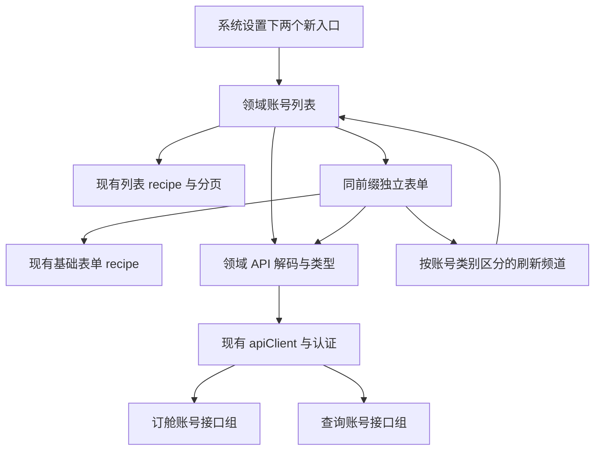
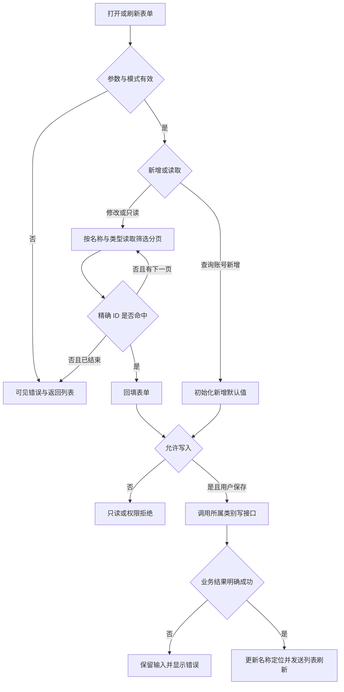
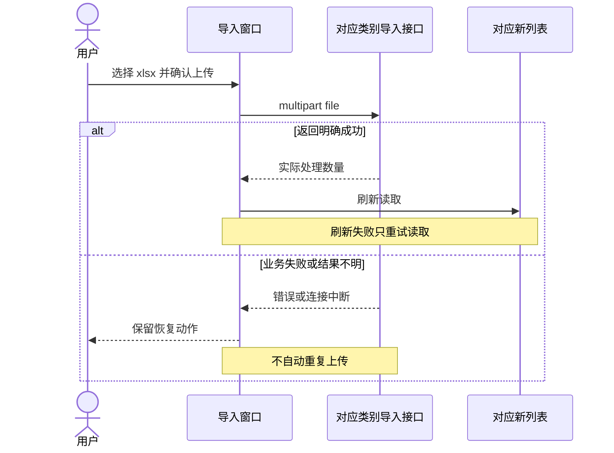

# MSK 订舱与查询账号管理 - Plan

## Goal Capsule

- **Objective:** 运营人员能在当前网站分别查询和维护 MSK 订舱账号、MSK 查询账号，并完成 Excel 导入与当前页导出。
- **Means:** 在既有系统设置菜单追加两页，按 KTD1–KTD6 接入项目列表、表单和 HTTP 能力。
- **Authority:** 用户本轮确认及前序需求分析 → `AGENTS.md` 与 `docs/ai/development-rules.md` → 本计划 Product Contract；接口方法和字段以已核对的 Apifox 契约为证据；发现冲突时显式澄清，不按模板猜接口。
- **Execution profile:** Standard；后续实现按一个完整变更组织，含 U1–U5。本轮交付计划，不实施业务代码；提交、PR、部署与真实数据写入不由本计划自动授权。
- **Stop conditions:** 只阻断受影响能力：U1 无法明确成功响应或分页契约时，不接通对应写操作或详情读取；发现已有入口行为必须改变时，先回到已确认范围。
- **Handoff:** 后续实施者完成代码、本地验证及浏览器验收；真实写入联调由获明确授权的执行者在约定测试数据范围内完成，未执行部分在验收记录中单列。

---

## Product Contract

### Summary

在“系统设置”下新增“MSK订舱账号”和“MSK查询账号”，保留现有入口。
两个页面使用当前项目的筛选、表格、表单和主题样式，参考图片只作为业务内容依据。
订舱账号提供查询、修改、Excel 导入和当前页导出；查询账号额外提供单条新增和删除。

### Problem Frame

现有账号页只有简化的只读列表，无法完成参考图中的账号维护和导入操作。
运营需要在当前网站处理两类账号，且能明确区分各自支持的操作。

### Key Decisions

- **追加入口。** 保留原入口以避免替换已有使用路径。Governs R1。（session-settled: user-directed — chosen over replacing the existing account entry: 用户明确要求保留现有入口。）
- **沿用项目样式。** 参考图提供内容与操作，不作为视觉复刻目标。Governs R2。（session-settled: user-directed — chosen over copying the reference UI: 用户要求使用当前项目样式。）
- **密码明文展示并参与导出。** 保持用户确认的业务内容。Governs R5。（session-settled: user-directed — chosen over masking passwords and excluding them from export: 用户明确选择按参考图明文显示且导出包含密码。）

### Requirements

**入口与页面**

- R1. 在系统设置分组现有两项之后追加“MSK订舱账号”“MSK查询账号”；保留 `/book_account_list`、`/get_base_list`、`/get_book_task_list` 及其他既有入口的名称、路径和行为。
- R2. 新页面沿用现有 Ant Design 6、TailwindCSS、template-kit 和 light/dark/system 主题；不复制参考系统侧栏、配色和留白。
- R3. 两页均提供账号、账号类型、是否使用刷新、是否启用、使用类型五项筛选；默认账号类型为 1，点击“查询”后生效，重置恢复默认条件并回到第一页。
- R4. 两页展示账号、密码、客户代码、是否使用刷新、是否启用、使用类型、更新时间及操作列；缺失可选字段有一致的空值表达。
- R5. 列表密码明文显示，当前页 Excel 导出包含密码列；该决定不扩展到 URL、日志、持久缓存或验收截图中的真实凭据。

**账号维护与文件**

- R6. MSK订舱账号支持修改、Excel 导入和导出当前页，不提供单条新增或删除入口。
- R7. MSK查询账号支持单条新增、修改、删除、Excel 导入和导出当前页；删除前确认目标账号及不可恢复后果。
- R8. 修改仅提交接口支持且实际变更的字段，以 `_id` 识别目标；未填写新密码（空字符串）表示不修改，新增账号必须填写密码且保留密码首尾空格。
- R9. Excel 导入上传 `.xlsx` 文件到对应账号类别，显示服务端返回的处理数量；失败保留恢复动作，写入结果不明时不自动重试上传。
- R10. 导出仅使用最近一次成功加载的当前页，字段范围与 R4 一致且不含操作列；不请求其他分页，加载中或结果未更新时暂停导出以免误认范围。

**权限与反馈**

- R11. 页面读取沿用 `list.read` / `form.read`，新增、修改、删除、导入使用 `form.write`；同时阻断无权限入口与写入回调，readonly 模式不得提交。
- R12. 新增、修改使用列表同前缀的独立基础表单页；新标签页及刷新后能按身份精确回填，非法参数、记录消失或读取失败提供返回或重试。
- R13. 列表和表单覆盖 loading、empty、error、partial 及适用的 readonly；业务失败不得因 HTTP 200 被当作成功，写入成功与后续读取失败分别反馈。

### Scope Boundaries

- 本次只增加账号管理前端能力及相关文档、测试；后端接口实现和原账号页增强均不在本次范围。
- 不增加批量删除、批量编辑、全部页导出、定时刷新、字典后台或导入解析库；当前需求没有对应操作或依赖依据。
- 不抽取新的平台级账号框架，不修改全局权限模型、AppShell、HTTP 认证或旧响应解包机制；领域内适配已足够承接本次差异。

### Acceptance Examples

- AE1. Covers R1, R12：打开任一新入口并进入修改页，新标签页和刷新后的菜单高亮都归属该账号列表，原入口仍可使用。
- AE2. Covers R3, R8：选择“否”或输入类型 0，查询和保存请求保留数值 0；仅改变筛选草稿不会影响已展示结果或编辑链接。
- AE3. Covers R5, R10：当前页为 20 条时，导出只含这 20 条的业务列和明文密码；不触发读取其他页。
- AE4. Covers R11：viewer 看不到写操作，直接访问修改地址或触发提交仍不发起写请求。
- AE5. Covers R9, R13：导入断网后展示结果未确认及重新查询入口，不自动重传；服务端明确成功后即使列表刷新失败，也不提示再次导入。

### Sources

- [Apifox 账号接口文档](https://o5bo7eto3k.apifox.cn/9664881m0)：前序需求分析已解锁并只读核对；密码不写入仓库。
- 用户提供的三张图片：系统设置新增入口、查询账号内容、订舱账号内容；本计划不复制图中的真实账号数据。
- `docs/api/README.md`、`docs/api/api.md`：现有已验证范围与实际写入验收边界。
- `docs/ai/development-rules.md`、`docs/testing-standards.md`：页面、权限、主题和验证约束。

---

## Planning Contract

### Business Classification

业务属于账号管理：列表归 `list-query` / `list-query-standard`，新增和修改归 `form-management` / `form-three-mode`。
表单采用基础表单：最多 8 个业务字段、单阶段录入，没有动态字段或复杂跨字段流程，符合 `docs/ai/page-recipes.yaml#formTemplateDecisionMatrix`。
订舱账号表单只开放 modify/readonly，直接访问 add 显示业务错误和返回入口。
查询账号表单支持 add/modify/readonly，readonly 不另建菜单或详情页。

### Page Modules

| 模块 | 选型与本次内容 |
| --- | --- |
| 筛选区 | `StandardListPageRecipe` 内置筛选表单；账号用 Input，两个布尔字段用可清空 Select，类型值见 A1 |
| 内容区 | 现有列表卡片、工具栏、Table、分页及列设置；按账号类别配置动作差异 |
| 表单区 | `BasicCrudFormRecipe`、`useFormModeAccess`、`useTemplateFormController`；复用统一返回页头与底部操作区 |
| 反馈区 | recipe 状态区、message、删除确认 Modal；仅保留字段约束、失败恢复和重要后果文案 |
| 权限区 | 路由 PermissionGuard + `hasPermission` / 表单模式访问；新页回调显式阻断提交 |

### Key Technical Decisions

- KTD1. **同域共用固定页面。** 新建 `src/pages/templates/msk-account-management/`，用固定的 booking/query 两种类别复用一份列表和一份表单，API 与配置在域内共用。两类字段基本相同，差异限于端点和少量动作；无需分别复制整页，也无需修改共享 recipe。Implements R2, R6, R7。
- KTD2. **四条独立路由。** 列表用 `/msk-book-account-list`、`/msk-query-account-list`，各自追加 `/form`。在 `routes.config.ts` 注册，表单不入菜单；现有 `resolveRouteByPath` 已支持同前缀高亮，无需改 AppShell。Implements R1, R12。
- KTD3. **领域内契约适配。** 复用 `apiClient` 及现有认证，在新 `api.ts` 明确列表、分页、单条写入、删除及导入响应类型。U1 先从原始文档/测试响应核实成功标志和 `error_code` 语义，再做领域解码；不能将旧 `bool_status` 成功规则直接套给新响应，也不能把字段缺失降为成功或空列表。业务错误需保留为现有 ApiError 可显示的消息，避免被 `normalizeApiError` 的普通 Error 分支覆盖。Implements R13。
- KTD4. **以已文档化的列表接口回填。** 编辑链接携带 `id`、`original_account`、最近成功查询所用的 `account_type`，用 `URLSearchParams` 编码；账号名称和类型只是缩小读取范围，身份始终按 `_id` 精确匹配。按筛选结果分页查找，不能只查第一页或取第一条近似账号。缺少名称提示时遍历该账号类型的列表，缺少类型时用接口默认 1；无匹配显示记录不存在，读取失败允许重试。改名成功后更新 URL 的名称提示，保持刷新可用。Implements R8, R12。
- KTD5. **复用跨标签刷新，不扩散到旧页。** 使用现有 `useListRefreshChannel`，在领域配置中为 booking/query 定义各自固定频道，保存、删除或导入明确成功后仅刷新对应新列表。表单导航需要额外定位参数，局部封装按现有 `window.open` 的新标签页方式打开，不扩展全局导航 hook。Implements R1, R12, R13。
- KTD6. **服务端导入、客户端导出。** 导入用现有 antd Upload 选文件并由用户点击确认上传，通过 FormData 的 `file` 字段发送，不手设 multipart boundary；Excel 解析和校验交给接口。导出沿用 `js-export-excel` 模式，显式选择 R4 业务列及 R5 密码，不展开原始对象。Implements R5, R9, R10。
- KTD7. **身份与精度。** 新列表 rowKey 使用 `_id`，不用旧只读页的账号/时间/行号组合。类型和布尔字段以数值传输，客户代码和账号保持文本；可选文本不套用密码处理规则。编辑时客户代码、账号类型只读，因为当前修改接口未列为可写字段。Implements R3, R4, R8。

### API Contract

以下路径来自前序已核对资料；U1 将补到 `docs/api/api.md`，区分文档事实、MSW 请求验证和真实联调。
修改统一采用文档允许的 POST，不为同一操作再提供 PATCH 分支。

| 操作 | 订舱账号 | 查询账号 |
| --- | --- | --- |
| 分页列表 | GET `/maersk/book/list` | GET `/maersk/list` |
| 单条新增 | 不提供 | POST `/maersk/account` |
| 修改 | POST `/maersk/book/list` | POST `/maersk/list` |
| 删除 | 不提供 | DELETE `/maersk/account/{account_id}` |
| Excel 导入 | POST `/maersk/book/account/import` | POST `/maersk/account/import` |

- 列表筛选：`page`、`per_page`、`account_type`、`account`、`is_refresh_use`、`is_use`、`use_type`；未填条件省略，0 保留。
- 列表实体：`_id`、`account`、`password`、`customer_code`、`is_refresh_use`、`is_use`、`use_type`、`update_time`。分页外层及页码字段以 U1 核实样例为准，统一为页面需要的 total/current/pageSize。
- 查询账号新增：必填 account/password；可选 account_type/customer_code/use_type/is_use/is_refresh_use。默认值沿用文档：类型 1、使用类型 1、两个布尔字段 1，客户代码空文本。
- 两类修改：`_id` 和变更过的 account/password/use_type/is_use/is_refresh_use。`matched=0` 不能提示保存成功；`matched>0, modified=0` 可以表达未发生修改。返回无法证明成功时保持输入，不冒充成功。
- 删除使用服务端 `_id`；`deleted=0` 表达账号已不存在并刷新，不反馈“已删除一条”。
- 导入结果使用 total/inserted/matched/modified 的实际返回值，匹配数不等同修改数。订舱导入的表头、空单元格和重复账号处理沿用原文档；查询账号导入须单独核对，不因字段相近就假设格式完全一致。
- 无专用详情、字典和导出接口，不虚构端点；两种类别按各自接口区分，不猜测 `use_type=2/3` 就是分类条件。

### Assumptions

- A1. `account_type`、`use_type` 暂按文档允许的非负整数用 InputNumber 录入/筛选，列表显示原始值；两个布尔字段明确用 Select。使用类型的中文映射尚无依据，不猜“2/3”的业务含义。获得正式字典后可在同字段换成 Select，本次不新造字典服务。
- A2. 新列表沿用现有账号页分页选项 10/20/50/100/500/1000、默认 100；500/1000 条读取局部使用 20 秒超时，不调整共享 client 的默认值。
- A3. 当前页导出沿用项目既有可读取列表权限；新增/编辑密码输入可用 Input.Password 的显示切换，但不改变 R5 的列表和导出内容。

### Risks and Implementation Gates

| 事项 | 实际后果 | 最小处理与解除条件 |
| --- | --- | --- |
| 文档摘要与旧解包不同 | HTTP 200 业务失败可能被误报成功 | U1 核对原始成功/失败样例并保存无真实凭据的 fixture；未明确前阻断对应能力 |
| 模糊查询、分页及账号改名 | 回填错误账号或改名后刷新找不到记录 | 按 KTD4 做精确 ID 定位；分页不前进、结构错误时显示读取失败，不继续无界请求 |
| 权限与 readonly 只禁 UI | 直接回调仍可能写入 | 页面提交与 mutation callbacks 均验证访问条件；覆盖零请求断言 |
| 导入超时但服务端可能部分写入 | 自动重试可能重复改变数据 | 按 R9 重新查询后由用户决定重传，区分成功处理与刷新失败 |
| 凭据参与明文展示和导出 | 页面数据可能被无意复制到其他产物 | 遵守用户已确认 R5；只使用虚构测试数据，避免真实密码进入 URL、日志、缓存及截图 |
| 列宽与主题只靠源码估计 | 表头折行或深色状态不可读 | 实施后浏览器测量和截图；无真实样本时明确不能宣称完成真实列宽验收 |

以上技术核对属于 U1 的实施前置工作，不阻断本计划交付；具体接口无法核实时才停止依赖该契约的后续单元。

### High-Level Technical Design

### Reuse and File Placement

沿用现有文件的模式，不修改原账号模块：

- `src/pages/templates/book-account-list/book-account-list-page.tsx`、`api.ts`：服务端分页、旧数据错误反馈和局部大页超时。
- `src/pages/templates/base-port-list/base-port-form-page.tsx`：基础表单、模式和访问控制。
- `src/pages/templates/order-list/order-list-page.tsx`：当前页数据引用与 Excel 显式列导出。
- `src/shared/template-kit/recipes/standard-list-page-recipe.tsx`、`basic-crud-form-recipe.tsx`：统一容器、状态与工具栏。
- `src/shared/template-kit/hooks/use-list-refresh-channel.ts`、`use-form-mode-access.ts`、`src/shared/hooks/use-standard-pagination.ts`：刷新、权限与分页。
- `src/routes/form-route-contract.ts`、`src/shared/components/form-page-header.tsx`、`src/infrastructure/http/api-client.ts`：模式、页头与传输。

---

## Implementation Units

### U1. Account API and Domain Contracts

- **Goal:** 建立两组账号的精确 API 契约和领域适配。
- **Requirements:** R3, R4, R8, R9, R13；KTD3, KTD4, KTD7。
- **Dependencies:** 无。
- **Files:** 新增 `src/pages/templates/msk-account-management/api.ts`、`account-config.ts`、`api.test.ts`；修改 `docs/api/api.md`。
- **Approach:**
  1. 核对 API Contract 尚待确认的响应、分页和两种导入格式，记录来源与验证范围。
  2. 在 `api.ts` 放类型、端点选择、解码和列表精确定位；`account-config.ts` 仅承载两类共用的固定路径、标题和刷新频道。
  3. 依 KTD3 适配业务错误，依 KTD7 序列化字段；详情读取沿 KTD4，复用 A2 超时策略。
- **Patterns:** 原账号 `api.ts`、`api.test.ts` 及基础端口 API；不照搬其非分页详情读取。
- **Test scenarios:**
  1. 两个类别分别请求正确列表和写路径，查询参数和页码一致。
  2. 类型与布尔 0 被保留，密码首尾空格不变；修改空密码不发送，新账号缺密码不提交。
  3. 响应成功、HTTP 200 业务失败、缺少成功证据及格式异常得到各自正确结果；业务消息可显示。
  4. 同名片段跨两页时只返回指定 `_id`；错误类型、缺失 ID、分页不前进或查询失败有可恢复错误。
  5. matched/modified/deleted 的边界不误报；两个上传端点收到正确 FormData file。
  6. 500/1000 大页读取仅局部超时改变，普通请求和共享 client 默认不变。
- **Test seam:** MSW 验证客户端请求与解码，不能证明真实写入落库。
- **Verification:** 每类 API 的成功与失败结构有证据，依赖接口不存在猜测，原模块契约不变。

### U2. Account Lists and Menu Entries

- **Goal:** 从系统设置进入两个新列表，完成筛选、分页及基础导航。
- **Requirements:** R1–R6, R11–R13；AE1, AE2；KTD1, KTD2, KTD5。
- **Dependencies:** U1。
- **Files:** 新增 `src/pages/templates/msk-account-management/msk-account-list-page.tsx`、`msk-account-list-page.test.tsx`；修改 `src/routes/routes.config.ts`、`src/routes/routes.config.test.ts`、`src/shared/layout/app-shell.test.ts`。
- **Approach:**
  1. 固定两种类别共用列表，通过命名导出绑定各自路由；先接入 `StandardListPageSpec`。
  2. 按 Page Modules 接入筛选、内容和反馈；采用 `_id`，必要的缺失身份行进入 partial 并禁止写操作。
  3. 追加菜单并保留旧项顺序；表单路由在 U3 随实际组件接入，不发布悬空链接。
  4. 列表读取采用稳定引用，区分筛选草稿与最近成功查询；列表数据、总数和动作定位使用同一次查询上下文。
- **Patterns:** 现有账号列表、基础端口列表和 AppShell 前缀匹配。
- **Test scenarios:**
  1. Covers AE1：菜单新增两项、旧项路径和分组不变；两页首次加载请求属于各自接口。
  2. Covers AE2：修改筛选不请求，查询后才生效；“否”和类型 0 正确发送，重置恢复类型 1 与第一页。
  3. 翻页、页大小变化和总数正确；两页的列设置偏好用不同 tableId。
  4. 请求失败保留旧数据并提供重试；空列表、partial 和缺 `_id` 行不提供错误目标操作。
- **Test seam:** jsdom 证明查询与路由元数据，菜单真实高亮和新标签交互由 U5 浏览器补齐。
- **Verification:** 新列表具备完整只读查询体验，新增/修改/导入/删除入口只随对应能力完成启用。

### U3. Account Forms and Query Account Deletion

- **Goal:** 完成两类修改、查询账号新增与删除。
- **Requirements:** R6–R8, R11–R13；AE1, AE2, AE4；KTD4, KTD5, KTD7。
- **Dependencies:** U1, U2。
- **Files:** 新增 `src/pages/templates/msk-account-management/msk-account-form-page.tsx`、`msk-account-form-page.test.tsx`；补充新列表文件及其测试、`routes.config.ts`、`routes.config.test.ts`。
- **Approach:**
  1. 按 Business Classification 接入基础表单和四条路由，局部导航携带已生效查询的定位信息。
  2. 新增/编辑字段按 API Contract 开放；将模式和写权限同时用于 UI、提交及 mutation callbacks。
  3. 保存成功更新 URL 定位值和表单基线，再通过 KTD5 刷新列表；失败保留输入，重置恢复当前基线。
  4. 查询账号删除依 R7 确认，发送中禁止重复提交；成功删除当前页最后一条时回退到有效页并读取。
- **Patterns:** 基础端口表单及现有列表动作；不修改共享 form controller 的既有行为。
- **Test scenarios:**
  1. Covers AE1：独立标签和刷新按 `_id` 正确回填；命中第二页同样有效，草稿类型不进入编辑链接。
  2. 查询新增有效字段保存成功；重复账号或业务失败保留输入并显示可用错误。
  3. 修改仅提交变更，账号改名后刷新仍命中同一 ID；密码省略与空格边界符合 R8。
  4. Covers AE4：viewer、readonly、非法 mode、缺 ID 和订舱 add 模式均不产生写请求。
  5. 删除取消零请求，确认使用正确 ID；失败保留行，deleted=0 与末页最后一行按 API Contract 正确处理。
  6. 保存成功只发送本类别刷新事件，列表刷新失败只重试读取；重置不恢复成改名前的定位。
- **Test seam:** 组件/API 测试验证请求、交互与刷新事件，真实服务保存须由 U5 的授权联调确认。
- **Verification:** 两类写操作严格区分，表单直达、刷新、权限拒绝和保存失败都有明确结果。

### U4. Excel Import and Current Page Export

- **Goal:** 完成两类 Excel 导入及包含密码的当前页导出。
- **Requirements:** R5, R9–R11, R13；AE3, AE5；KTD6。
- **Dependencies:** U1, U2。
- **Files:** 修改新列表文件及其测试、领域 API 及其测试；上传状态和表单局部放在列表文件中，不引入新的全局上传设施。
- **Approach:**
  1. 用 Modal + Upload 提供文件选择、确认、取消和上传中状态；重选/关闭清理文件状态。
  2. 展示所选类别实际导入格式和必要字段约束，结果数量在操作完成位置出现，不增加常驻功能介绍。
  3. 当前页导出显式构造 Excel 数据，空页不生成文件；状态和日期用界面业务值，密码按 R5 原值导出。
- **Test scenarios:**
  1. 两类上传分别选择正确端点，取消不上传；无文件、错误扩展名和重复点击不能产生多次上传。
  2. 成功显示服务端真实数量并仅刷新对应新列表；验证失败保留可修正操作。
  3. Covers AE5：超时不自动重传，明确成功但刷新失败不再次上传。
  4. Covers AE3：导出与当前页成功快照一致，含密码且不含 `_id`/操作；不额外请求分页。
  5. 只改筛选草稿不改变导出范围；加载中、失败未更新或空页时不能误导出。
  6. 无 form.write 时导入入口和上传回调均阻断，读取与既定导出权限不受影响。
- **Test seam:** mock 上传与 Excel 导出数据可证明前端行为，不证明后端表格解析、真实文件可打开或实际落库。
- **Verification:** 使用虚构账号生成并打开 Excel 样本，确认账号/客户代码等文本和密码未被改写；真实导入只在约定测试数据范围验证。

### U5. Browser Acceptance and Regression

- **Goal:** 验证主题、文案、列宽和跨页面行为，留下准确验收记录。
- **Requirements:** R1–R13；AE1–AE5。
- **Dependencies:** U2, U3, U4。
- **Files:** 新增 `src/pages/templates/msk-account-management/msk-account-management.browser.test.tsx`、`docs/plans/2026-11-23-msk-account-management-verification.md`；必要调整仅限新域文件。截图放 `/.artifacts/screenshots/2026-11-23-msk-account-management/`，沿用已有 ignore，不暂存截图。
- **Approach:**
  1. 复用现有 Rstest Browser Mode 和 `src/test/browser-mode-smoke.browser.test.tsx` 模式覆盖组件交互，测试内拦截接口并使用虚构账号。完整跨标签旅程通过真实浏览器冒烟执行，分别以有写权限和只读角色验收，不新增 E2E 运行框架。
  2. 在 light/dark/system 下核对真实渲染、菜单、统一表单返回头、导入窗口和失败恢复。
  3. 按 `docs/ai/list-column-width-rules.md` 测量真实样本，操作列按规则计算固定宽度；测量结果写注释和验收记录。
  4. 单独审查新增用户可见字符串，对照渲染移除重复说明，记录实际删减和必要保留例子。
- **Test scenarios:**
  1. 系统设置进入两页，修改新标签与刷新保持菜单归属；旧入口仍能查询且行为未变。
  2. 编辑/导入后对应列表更新，另一个账号类别和旧页不被新频道刷新。
  3. 只读角色不能绕过入口提交，写角色完成新增、修改、取消删除、导入及含密码导出。
  4. 错误态可恢复，表头单行；前 20 条样本的列宽按 P90 验证，空数据明确标注测量未完成。
- **Test seam:** Browser Mode 验证真实 DOM 下筛选、表单和文件交互；菜单跨页、新标签与刷新旅程由运行中的应用冒烟补齐，记录步骤及结果。主题/列宽须人工对照，MSW 通过不替代服务端写入验证。
- **Verification:** 完成下方 Verification Contract，验收记录分别报告本地验证、真实读取、授权写入和未验证项。

---

## Verification Contract

以下是后续实施检查，本次写计划不运行。

| 检查 | 范围及完成信号 |
| --- | --- |
| 领域与页面定向测试 | `bun run test src/pages/templates/msk-account-management/`：U1–U4 的正常、失败及边界场景通过 |
| 路由与旧行为回归 | `bun run test src/routes/routes.config.test.ts src/shared/layout/app-shell.test.ts src/test/permissions.test.ts src/pages/templates/book-account-list/`：旧入口、权限矩阵和菜单归属不变 |
| 完整项目测试 | `bun run test` 全绿；失败记录实际原因，不以定向测试替代仓库要求 |
| 类型、代码卫生与构建 | 项目现有 TypeScript、ESLint 配置及 `bun run build` 通过，无新增未使用项或 antd deprecated API |
| 浏览器组件测试 | `bun run test:browser src/pages/templates/msk-account-management/msk-account-management.browser.test.tsx`：真实 DOM 交互通过，复用已有 Chromium provider |
| 应用旅程冒烟 | 通过 `bun run dev:test` 启动本地测试应用，用真实浏览器完成 U5 新标签页、刷新、权限、上传/下载和主题旅程，记录测试数据来源、复现步骤和结果 |
| 真实接口 | 先只读核对分页及字段；后续真实写入仅使用明确授权的测试账号数据，记录持久化读取结果，未授权则明确未验证 |
| 文案与视觉 | 实际渲染核对；保留文件格式约束和删除后果，移除“选择文件后点击导入”之类重复操作说明，并在验收中给出实际例子 |

---

## Definition of Done

- U1 的契约有明确证据，U2–U4 的功能和 U5 的验收满足其 Verification，未解决的接口问题不被写成已完成。
- Product Contract 的 R1–R13 均有对应验证结果，所有新增功能至少含正常与失败/边界覆盖。
- R1 的旧入口及旧模块未被替换或顺手增强，R5 的明文展示和密码导出按用户确认完成。
- 模板复用、模式校验、写权限阻断、状态恢复、主题、文案和列宽检查完成；尚缺真实样本或联调时具体列明。
- 临时调试与废弃尝试已移除，截图和真实凭据不进入暂存区，diff 只含本次域模块、必要路由/测试和文档。
